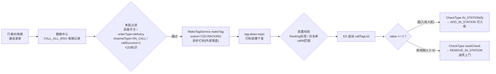
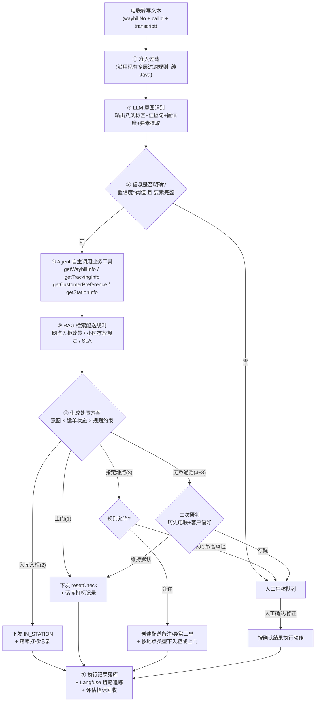

# 物流异常电联智能处理 Agent — 设计方案

> 业务蓝本：`yzd-waybill-mgm` 圆准达「异常上报 + 电联意图识别打标」流程
> 定位：作品集主项目，体现 LLM / Tool Calling / RAG / Agent Workflow / 评估与可观测的完整工程闭环

---

## 一、业务背景与现状

### 1.1 现有流程（规则驱动）

圆准达产品在派件环节通过 95 号电联联系客户，通话经智慧语音平台转写并打标，系统消费打标结果后驱动末端动作：



### 1.2 现有打标标签体系（Racking value 1~8，业务契约，不可擅改）

| value | 含义 | 现有系统动作 |
|-------|------|--------------|
| 1 | 上门 | resetCheck → 送货上门 |
| 2 | 入库入柜 | IN_STATION → 可入柜 |
| 3 | 指定地点 | resetCheck → 送货上门（**客户指定地点需求被丢弃**） |
| 4 | 引导推诿 | resetCheck → 送货上门 |
| 5 | 系统音 | resetCheck → 送货上门 |
| 6 | 仅一方发言 | resetCheck → 送货上门 |
| 7 | 语义混乱 | resetCheck → 送货上门 |
| 8 | 与快递无关 | resetCheck → 送货上门 |

### 1.3 痛点 → Agent 化价值

| 现状痛点 | Agent 化后的能力 |
|----------|------------------|
| 打标由外部平台黑盒完成，只有 value，无推理过程 | 自研意图识别，输出结构化 JSON：意图 + 证据句 + 置信度 + 提取要素 |
| 「指定地点」(value=3) 一刀切当上门，客户"放门卫/放驿站"需求被丢弃 | 提取指定地点要素 → 检索网点配送规则 → 可执行则写配送备注/异常工单，真正闭环 |
| 「系统音/仅一方发言/语义混乱」等无效通话也直接下发送货上门，可能误伤已约入柜客户 | 结合运单状态、历史电联、客户偏好二次研判；置信度不足转人工审核 |
| 无人工审核通路，模型判错无法拦截 | Human-in-the-loop：低置信、高风险动作必须人工确认后执行 |
| 无评估体系，无法回答"识别准不准、改 Prompt 有没有变好" | 评估数据集 + 八类 Precision/Recall/混淆矩阵 + Langfuse 全链路追踪 |
| 动作执行与判断耦合，失败无重试、中断无恢复 | 工作流状态机：步骤落库、有限重试、中断恢复、幂等控制 |

**设计原则（红线）**：意图理解、要素提取、语义研判交给 LLM；运单查询、准入校验、标签映射、CheckType 下发、工单创建等确定性操作全部由 Java 业务代码执行。最终对外业务动作与现有系统保持一致（IN_STATION / resetCheck），保证可回切、可灰度对比。

---

## 二、Agent 化后的目标流程



与现有系统的对应关系：② 替代外部 MakeTagService 黑盒打标；③~⑥ 为新增 Agent 决策层；⑦ 的打标记录结构对齐 `CallTagRecord`（tagCode/tagName/value/contextSentence），动作出口对齐 `oc-yzd-check-topic` 的 CheckType 语义。

---

## 三、技术架构

| 层级 | 技术选型 | 说明 |
|------|----------|------|
| 后端 | Java 21 + Spring Boot 3 | 复用 Java 后端工程能力 |
| AI 框架 | Spring AI（ChatClient / @Tool / Structured Output / VectorStore） | 不同时引入第二套编排框架，工作流状态机自研 |
| 大模型 | Qwen（OpenAI 兼容协议接入，可切换内网网关/其他模型） | 模型可配置，便于效果对比 |
| RAG | Embedding + PostgreSQL pgvector + Rerank | 配送规则、网点政策、SLA 知识库 |
| 数据库 | PostgreSQL（业务 + 任务状态）+ pgvector | 任务记录、审核结果可靠持久化 |
| 缓存 | Redis | 运单简要信息缓存、幂等控制、灰度开关 |
| 消息队列 | RocketMQ | **对齐参考业务现状**（电联记录接入、打标结果、CheckType 下发均走 MQ 异步） |
| 可观测/评估 | Langfuse | Prompt 管理、调用链追踪、数据集实验 |
| 部署 | Docker Compose | 一键拉起 PG/Redis/RocketMQ/Langfuse/应用 |
| 前端（阶段5） | React | 任务列表、执行轨迹、人工审核台 |

### 模块划分

```
LogisticsExceptionHandlingAgent/
├── docs/                          # 设计文档
├── backend/
│   ├── agent-common/              # 常量枚举(Racking标签/CheckType)、DTO、MQ消息体
│   ├── agent-business/            # 运单/轨迹/网点/偏好/工单 领域服务 + Mock 数据
│   ├── agent-core/                # Agent 核心：Prompt、意图识别、Tool Calling、RAG、工作流状态机
│   ├── agent-consumer/            # MQ 消费者：电联记录接入、打标结果下发(模拟)
│   └── agent-admin/               # REST API：任务查询、人工审核、评估报表
├── frontend/                      # 阶段5：审核台与执行轨迹
├── deploy/docker-compose.yml
└── README.md
```

---

## 四、核心设计

### 4.1 意图识别结构化输出（阶段1交付物）

```json
{
  "tagCode": "Racking",
  "value": "3",
  "intentName": "指定地点",
  "confidence": 0.92,
  "contextSentence": "我白天不在家，你把快递放在小区门卫那里就行",
  "extracted": {
    "locationType": "门卫",
    "locationDetail": "小区门卫",
    "timePreference": null
  },
  "needHumanReview": false,
  "reason": "客户明确表达指定地点投递，地点要素完整"
}
```

要点：八类标签枚举强约束（JSON Schema）、必须返回原文证据句（防幻觉、可审计）、置信度低于阈值强制 `needHumanReview=true`。

### 4.2 Agent 工具清单（Tool Calling）

| 工具 | 功能 | 对应现有系统能力 |
|------|------|------------------|
| getWaybillInfo | 查询运单信息（产品标识、收件信息、当前状态） | ES queryByWaybill / Redis getSimpleInfo |
| getTrackingInfo | 查询物流轨迹 | 数据中心操作记录 |
| getCustomerPreference | 查询客户配送偏好、历史电联结论 | call95ResultList / callTagList |
| getStationInfo | 查询配送站点与可入柜配置 | 可入柜判断配置（排除客户/产品/网点） |
| searchDeliveryPolicy | RAG 检索配送规则、SLA | 新增（现有无此能力） |
| saveCallTag | 落库打标记录（含证据句） | ES 追加 callTagList（去重） |
| sendCheckType | 下发 IN_STATION / resetCheck | oc-yzd-check-topic |
| createExceptionTicket | 创建异常工单（指定地点协商、投诉风险） | 新增 |
| updateDeliveryRemark | 更新配送备注（指定地点要素） | 新增 |
| submitHumanReview | 提交人工审核 | 新增 |

模型只发起调用请求；参数校验、权限、幂等、重试由 Java 工具层负责。写操作工具（saveCallTag / sendCheckType / createExceptionTicket / updateDeliveryRemark）在工作流中受「审核门」控制，不允许模型随意直达。

### 4.3 工作流状态机

```
RECEIVED → FILTERED → INTENT_RECOGNIZED → CONTEXT_ENRICHED(工具+检索)
→ PLANNED → [AWAITING_REVIEW] → EXECUTING → DONE
                                   ↘ FAILED(可重试/可恢复)
```

- 每次状态迁移落库（`agent_task` + `agent_task_step`），记录输入/输出/耗时/Token。
- 工具调用失败有限次重试（指数退避），超过上限进入 FAILED，可从最后成功步骤恢复。
- 幂等：`waybillNo + callId + tagCode` 唯一约束，MQ 重复消费不产生重复动作。
- 灰度：沿用 `enableYzdRacking` 开关思路，支持按网点灰度，新旧打标结果双写对比。

### 4.4 RAG 知识库

| 知识类型 | 示例 | 用途 |
|----------|------|------|
| 网点入柜政策 | 某网点 excludedProducts / 排除客户清单 | 判断入柜动作是否可执行 |
| 小区/末端存放规定 | "XX小区所有包裹须放物业快递柜" | 指定地点要求能否满足、是否需工单协商 |
| 异常件处理规范 | 引导推诿话术的上报要求 | 无效通话二次研判与工单类型选择 |
| 配送 SLA | 圆准达上门时效承诺 | 处置方案合规性校验 |

文档 → Chunking → Embedding → pgvector；检索后 Rerank 取 Top-N 注入规划 Prompt；附评估集衡量召回命中率。

### 4.5 核心表（PostgreSQL）

| 表 | 关键字段 | 说明 |
|----|----------|------|
| agent_task | id, waybill_no, call_id, status, final_value, gray_flag, idempotent_key(唯一) | 任务主表 |
| agent_task_step | id, task_id, step_name, input_json, output_json, tokens, latency_ms, retry_count | 步骤轨迹（中断恢复依据） |
| call_tag_record | id, task_id, tag_code, tag_name, value, context_sentence, confidence, model_version | 打标记录（对齐 CallTagRecord + 评估扩展字段） |
| human_review | id, task_id, reason, suggested_action, review_result, reviewer, reviewed_at | 人工审核 |
| exception_ticket | id, waybill_no, ticket_type, content, status | 异常工单 |
| policy_document / policy_chunk | 文档与向量切片 | RAG 知识库 |
| eval_dataset / eval_result | 评估样本与跑分结果 | 效果度量 |

---

## 五、开发阶段规划

| 阶段 | 交付物 | 体现的技术点 |
|------|--------|--------------|
| 1. LLM 应用基础 | 电联转写文本 → 八类意图结构化 JSON（证据句+置信度）；模型调用超时/失败处理 | Prompt Engineering、Structured Output、JSON Schema |
| 2. 业务工具接入 | 运单/轨迹/网点/偏好 Mock 服务；Agent 按需自主调用查询工具；打标落库 + CheckType 下发 Mock | Spring Boot、@Tool、Function Calling、参数校验与幂等 |
| 3. RAG 知识库 | 配送规则入库检索；指定地点场景的规则约束判断 | Embedding、pgvector、Chunking、Rerank |
| 4. Agent 工作流 | 状态机 + 人工审核台 API + 失败重试 + 中断恢复；指定地点工单/备注闭环；无效通话二次研判 | Workflow、State、Human-in-the-loop、RocketMQ |
| 5. 质量与工程化 | 评估数据集（八类 P/R/混淆矩阵）、Langfuse 接入、Docker Compose 部署、React 审核台 | Evaluation、Observability、DevOps |

每个阶段独立可运行、可演示；阶段 1+2 完成即可演示「文本进 → 打标+动作出」的最小闭环。

---

## 六、评估指标（设计目标，非实测成绩）

| 指标 | 目标示例 |
|------|----------|
| 八类意图分类准确率 | ≥ 95%，附各类 Precision/Recall 与混淆矩阵 |
| 结构化 JSON 合法率 | ≥ 99% |
| 工具调用成功率 | ≥ 99% |
| 动作下发幂等正确率 | 100%（重复消息零重复动作） |
| 人工审核率 / 审核改判率 | 实测，用于校准置信度阈值 |
| 单任务平均模型调用次数 / Token 消耗 / 耗时 | 实测并优化 |

---

## 七、待确认事项

1. **转写文本来源**：演示项目使用构造的通话转写样本（含八类典型语料）；真实场景由智慧语音平台转写后随电联记录下发，本项目按「文本已就绪」设计输入。
2. **动作出口**：演示环境 CheckType 下发与工单创建以 Mock + 落库 + MQ 消息呈现，语义与字段对齐现有系统，不对接真实下游。
3. **指定地点(value=3) 的动作扩展**属于新能力：现有系统对该值只下发送货上门，本项目新增「规则允许时写配送备注/工单」，属于增强而非替换，汇报时需明确区分。
