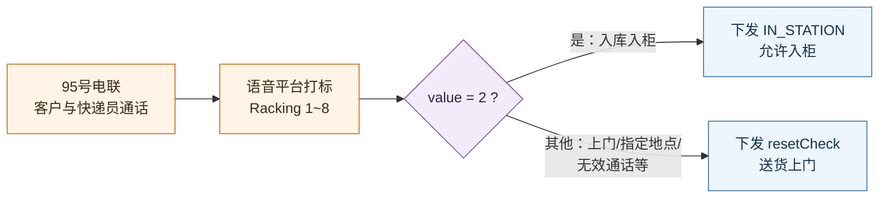
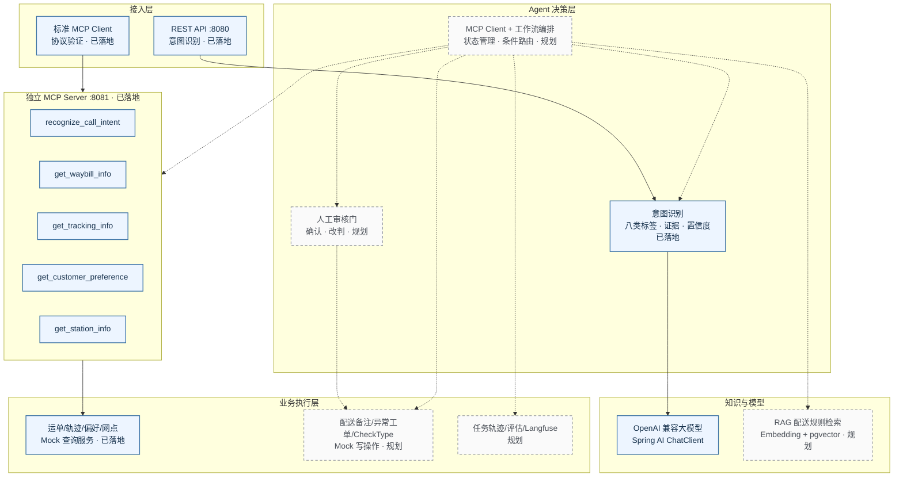
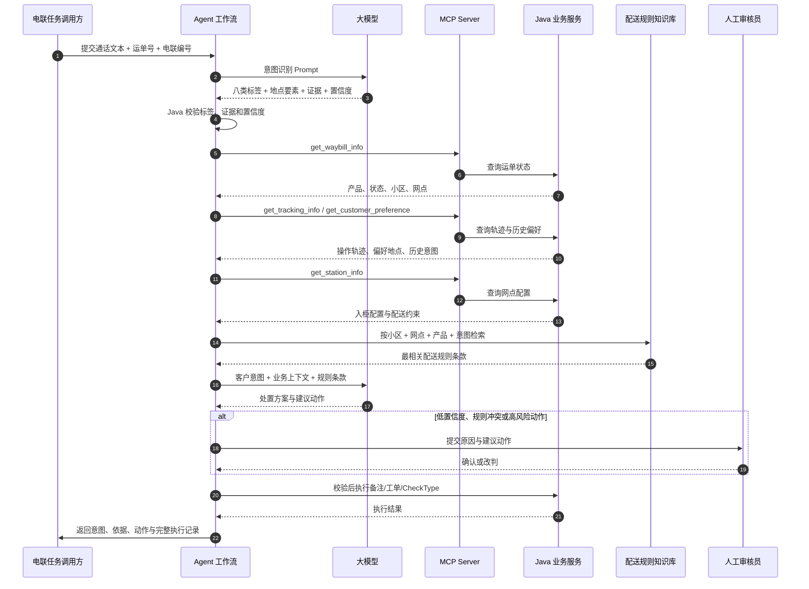

# 物流异常电联智能处理 Agent — 项目阶段汇报

> **项目目标**：将圆准达电联流程从“识别客户意图”，升级为“结合运单与配送规则，安全完成异常处置”。
>
> **汇报口径**：截至 2026-11-17。图中实线为已落地能力，虚线为后续规划，不将设计目标作为已完成成果汇报。

---

## 一、项目背景

圆准达产品在派件环节通过 95 号电联联系客户，智慧语音平台将通话内容识别为 Racking 八类意图。原系统根据标签直接下发末端动作：只有“入库入柜”下入柜，其余标签一律按送货上门处理。

这一流程完成了自动打标，但打标结果与真实配送处置之间仍存在断点。

## 二、解决了什么痛点

| 业务痛点 | 本项目的解决思路 |
|----------|------------------|
| **客户指定地点需求被丢弃**：客户说“放门卫”，原流程仍按普通上门处理 | 提取具体地点，结合网点规则决定配送备注、异常工单或人工确认 |
| **打标只看文本，不看业务现场**：不知道运单是否已签收、网点能否入柜、客户过去偏好 | 通过 MCP 工具查询运单、轨迹、客户偏好和网点信息，再形成处置方案 |
| **结果无法解释**：外部平台只返回标签值，判错后难以追溯 | 输出原文证据、判断原因和置信度，Java 自动校验标签与证据合法性 |
| **低置信结果也直接执行**：语义混乱、系统音等场景仍可能触发默认动作 | 低置信度强制转人工，高风险写操作必须经过审核门 |
| **配送规定没有参与判断**：小区、网点和 SLA 规则分散 | 通过 RAG 检索相关条款，模型负责理解，Java 负责硬约束校验 |
| **执行过程不可控**：缺少审核、重试、幂等、恢复和效果评估 | 通过工作流状态机记录每一步，形成可控制、可恢复、可评估的闭环 |

**核心价值**：原系统回答“客户说了什么”，Agent 进一步回答“这张运单现在应该怎么办，以及能否安全执行”。

## 三、总体方案

采用“**AI 理解决策 + Java 确定性执行**”的混合架构。大模型不直接操作数据库或下发指令，所有业务动作都通过可校验、可审计的 Java 工具完成。

- **输入**：电联转写文本、运单号、电联编号。
- **理解**：识别 Racking 八类意图，提取地点、时间、证据和置信度。
- **补充上下文**：查询运单、轨迹、客户偏好和网点信息。
- **规则判断**：检索配送规则，生成可解释的处置方案。
- **风险控制**：低置信度或高风险动作转人工审核。
- **执行与留痕**：写配送备注、创建工单、下发 CheckType，并保存执行轨迹。

## 四、系统架构流程图

### 当前两个可启动应用

| 应用 | 端口 | 当前职责 |
|------|------|----------|
| `agent-admin` | 8080 | 提供电联意图识别 REST API |
| `agent-mcp` | 8081 | 通过 `/mcp/sse` 对外提供 5 个只读 MCP 工具 |

## 五、Agent 交互逻辑

下图是目标交互闭环。其中“意图识别、MCP 工具、业务查询”已落地；“Agent 自主编排、RAG、人工审核和写操作”属于下一阶段。

### 一次“放小区门卫”请求如何判断

1. 意图识别为“指定地点”，提取“小区门卫”。
2. 查询运单，确认是否正在派件，避免已签收后仍下发动作。
3. 查询历史偏好，判断客户是否长期偏好门卫投递。
4. 检索到“该小区优先放快递柜，放门卫需人工确认”。
5. Agent 不直接执行，而是提交人工审核，并附上客户原话和规则依据。

## 六、当前 MCP 工具

| 工具 | 业务作用 |
|------|----------|
| `recognize_call_intent` | 识别八类电联意图，返回证据、置信度、地点要素和审核标记 |
| `get_waybill_info` | 查询产品标识、运单状态、收件小区和配送网点 |
| `get_tracking_info` | 查询派件上车、电联等物流操作轨迹 |
| `get_customer_preference` | 查询客户配送偏好、偏好地点和最近电联意图 |
| `get_station_info` | 查询网点入柜配置、排除产品和配送约束 |

当前全部为**只读工具**。配送备注、异常工单和 CheckType 写操作暂不通过 MCP 直接暴露，防止绕过后续人工审核门。

## 七、关键职责边界

| 交给大模型 | 必须交给 Java |
|------------|---------------|
| 理解非结构化通话文本 | 参数、权限和运单状态校验 |
| 识别意图、提取地点和时间 | Racking 标签与 CheckType 映射 |
| 根据上下文选择查询工具 | MCP 工具真实执行与异常处理 |
| 结合规则生成处置建议 | 人工审核门、幂等、重试和状态持久化 |
| 对不确定情况给出转人工原因 | 备注、工单、CheckType 等最终写操作 |

这一边界保证了系统的 AI 能力，同时避免“模型输出什么就直接执行什么”。

## 八、当前成果与验证

- 建成 Maven 多模块工程：`agent-common`、`agent-business`、`agent-core`、`agent-admin`、`agent-mcp`。
- 完成八类意图识别、结构化输出、原文证据校验和低置信度审核标记。
- 支持 Mock 与 OpenAI 兼容大模型两种 Provider，真实模型可通过环境变量接入。
- 建成独立 MCP Server，完成 5 个只读工具暴露。
- 全量 `mvn clean package` 通过，**14 个自动化测试全部成功**。
- 使用真实 Java MCP Client 通过 SSE 完成工具发现、运单查询和意图识别调用验证。

当前业务数据为 Mock，尚未宣称真实模型识别准确率；真实大模型效果需要后续评估数据集验证。

## 九、下一阶段计划

| 优先级 | 工作内容 | 形成的业务结果 |
|--------|----------|----------------|
| 1 | 在 Agent 内部接入 MCP Client 和工作流编排 | Agent 能自主完成“识别 → 查询 → 再判断”，不再依赖外部客户端逐个调用 |
| 2 | 建设配送规则知识库，接入 Embedding 与 pgvector | 指定地点和异常场景能够依据真实条款处置 |
| 3 | 增加任务状态、人工审核和 Mock 写操作 | 形成“方案 → 审核 → 备注/工单/CheckType”的完整闭环 |
| 4 | 建立评估数据集、执行轨迹和 Langfuse 观测 | 能量化识别准确率、工具成功率、Token 成本和任务耗时 |

## 十、总结

本项目不是给原系统简单增加一个大模型分类接口，而是在建设一套**能理解客户、能查询业务、能依据规则、能受控执行的物流异常处置 Agent**。

当前已完成意图识别和 MCP 工具底座，下一阶段重点打通自主编排与审核执行闭环。
